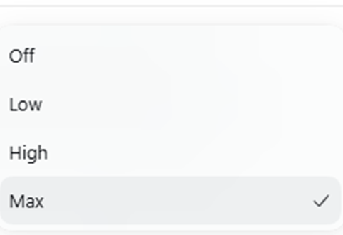

# dsh-official-reasoning-effort

[](https://github.com/Ayowait/dsh-official-reasoning-effort)
[](LICENSE)

> 让中转站 / 自定义 Provider 的模型也能像官方一样选择「思考强度」，且 UI 与官方完全一致
> （直接复用官方组件，不重写任何界面）。

## 它解决什么问题

很多中转站 API（例如 `deepseek-v4.1-flash`）本身没有「思考强度」这个参数可调，
但其实只要把请求发出去，上游就能正常反馈。官方的 composer 面板只在**模型由适配器
声明了推理等级**时才显示「推理等级」行 —— 于是这类网关模型在官方界面上根本看不到
这个选项。

本插件做两件事：

1. **补齐数据（核心）**：服务端对 `llm-pi-ai` 里**每个缺少 `reasoningEfforts` 的模型**，
   追加 `off / low / high / max` 四档（追加式写入，绝不覆盖已有声明，包括 `false`）。
   这样**官方自带的** composer 面板会自己显示「推理等级」行并允许选择——
   UI 完全是官方原版，插件不重写、不替换任何官方组件。
2. **一行小字提示**：仅当上游**没有原生声明**推理强度时，在**官方展开面板底部**
   用 CSS `::after` 追加一行小字（不改官方 DOM / 组件）：

> 上游未声明思考强度，此处为通用档位，上游可能忽略或拒绝。

支持该能力时不会显示这行提示。匹配用的是 **Provider + 模型组合**
（官方菜单节点上的 `data-provider-id` / `data-model-id`），因此同一个模型 id 由另一个
真实支持推理的 Provider 提供时不会被误判为「未声明」。




## 档位

- 默认四档，与官方完全一致：`Off` / `Low` / `High` / `Max`。
- 名称来源：`llm-pi-ai` 展示时按档位 id 首字母大写生成名称，因此注入
  `off / low / high / max` 四个 id 即原样显示，界面不做任何改动。

### 为什么要同时写 `reasoning: high`

只补 `reasoningEfforts` 时会出现**五档**（多一行 `Default`）。官方组件把档位列表拼成：

```js
[...(reasoning.defaultEffort === undefined
     ? [{ effort: undefined, label: t('effort.providerDefault') }]  // ← 多出来的 Default
     : []),
 ...reasoning.efforts.map((effort) => ({ ... }))]
```

而 `defaultEffort` 由 `llm-pi-ai` 从 **Provider 级** 的 `reasoning` 字段推导
（`reasoningInfo(model, profile.reasoning)`）。Provider 没写 `reasoning` 就没有
`defaultEffort`，于是「Default」+ 四档 = 五档。
官方 `dsh-llm-deepseek` 始终给出 `defaultEffort`（默认 `high`），所以内置 Provider 只有四档。

因此插件在为某 Provider 补齐档位时，会同时写入 `reasoning: high`（High 是官方定义的
「大多数任务的最佳平衡」）。已显式配置的 `reasoning` 不会被覆盖，无需补齐的 Provider
也不会被动到。

- 如果上游 / 模型**实际公布了更多档位**，则按实际公布的全部档位显示；
- 发送请求时，档位映射为上游的推理强度字段（沿用 `pi-ai` 适配器机制，默认为档位名
  本身，可在配置中覆盖）。

## 安装

```sh
dsh plugin --profile <你的-profile> add github:Ayowait/dsh-official-reasoning-effort
```

`lib/` 已预构建提交在仓库里，从 GitHub 安装无需本地编译；浏览器端是普通副作用模块，
也无需额外的打包步骤。

## 配置

默认零配置：自动发现 `llm-pi-ai` 中所有已存在的 Provider，并为其中缺少声明的模型
补齐通用档位。只有特殊网关需要不同 wire 值 / 需要排除某个 Provider / 需要单独处理
模型时，才在最终使用的 Cordis patch 中覆盖：

```yaml
- insert:
    - id: dsh-official-reasoning-effort
      name: dsh-official-reasoning-effort
      config:
        efforts:            # 所有 Provider 的默认 wire 值
          high: reasoning_high
        providers:
          special-gateway:
            efforts:
              max: max_reasoning
            models:
              non-reasoning-model:
                disabled: true   # 显式标记该模型不使用推理强度
          excluded-provider:
            disabled: true       # 排除整个 Provider
```

### 配置字段

| 字段 | 作用 |
| --- | --- |
| `auto` | 是否自动发现全部现有 Provider，默认 `true`；设为 `false` 时只处理 `providers` 中显式列出的项。 |
| `efforts` | 覆盖所有 Provider 的 wire 值映射（默认 `off/low/high/max → 同名`）。 |
| `defaultEffort` | 补齐档位时写入的 Provider 默认档（默认 `high`，即官方默认）。 |
| `syncDefaultEffort` | 设为 `false` 时不写 Provider 默认档（此时官方面板会多一行 `Default`）。 |
| `providers.<id>.efforts` | 覆盖指定 Provider 的 wire 值。 |
| `providers.<id>.disabled` | 排除指定 Provider。 |
| `providers.<id>.models.<model>.efforts` | 单独覆盖某个模型的 wire 值。 |
| `providers.<id>.models.<model>.disabled` | 显式标记某个模型不使用推理强度（写成 `reasoningEfforts: false`）。 |

## 安全默认

- 已有 `reasoningEfforts`（包括 `false`）**永远不被覆盖**；
- 重复注入是幂等的：某个模型已持有与本插件会写入的通用档位**完全相同**的值时，会被
  识别为「本插件上次自己写入的」（提示小字继续显示），而真实的原生声明不受影响；
- 迁移：旧版 0.2.x 写入的 `{low, medium, high}` 档位集合会被识别并一次性升级为
  `off / low / high / max`；
- 模型中与推理无关的字段保持不变；
- 服务端半是**零依赖**的（不 import 任何 `@deepseek-ai/*`）——这些包在 profile 插件的
  安装目录下无法解析，一旦 import 会导致整个 host bundle 加载失败、应用崩溃；
- `llm-pi-ai` 延迟注册时短暂重试；settings 更新后重新同步；
- 不新增 Provider 凭据、请求、工具或遥测；
- 只读路由 `GET /dsh-official-reasoning-effort/api/injected` 仅返回被补齐的
  `provider\\u0000model` 清单，供浏览器端决定是否显示提示小字。

## 本地开发 / 测试

```sh
npm test
```

测试覆盖：服务端补齐逻辑（`test/host.test.mjs`）、浏览器端渲染树（`test/client.test.mjs`）、
服务端集成与只读路由（`test/host-integration.test.mjs`）。

## 许可证

MIT
